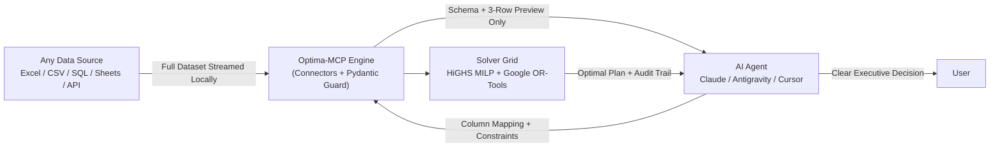

<div align="center">

# ⚡ Optima-MCP

### Stop letting LLMs guess your math.
**A Universal, Zero-Hallucination Operations Research & Decision Intelligence MCP Server for Claude, Antigravity, Cursor, and any AI Agent.**

[](LICENSE)
[](https://www.python.org/downloads/)
[](https://modelcontextprotocol.io/)
[](#built-in-mathematical-solvers)

[Quick Install (1 Link)](#-install-in-10-seconds-zero-setup) • [How It Works](#-the-solution-neuro-symbolic-decision-intelligence) • [Connectors](#-universal-data-connectors-plug--play) • [Solvers](#-built-in-mathematical-solvers) • [Examples](examples/)

</div>

---

## 🚨 The Problem

Large Language Models are **probabilistic** — they predict the next likely token. Ask an LLM to plan inventory for 500 SKUs under budget, storage, and supplier constraints, and it will confidently hallucinate suboptimal (or mathematically impossible) numbers.

## 💡 The Solution: Neuro-Symbolic Decision Intelligence

**Optima-MCP** splits the job in two:
1. **Your AI Agent (Flexible Adapter):** Inspects any messy database, Excel sheet, Google Sheet, or API — maps the columns, captures your business rules, and explains the outcome.
2. **Optima-MCP (Deterministic Math Brain):** Streams your full dataset locally into industrial-grade Operations Research solvers (**HiGHS MILP/LP** & **Google OR-Tools CP-SAT / VRP**) to compute the **single mathematically proven optimal decision** in milliseconds — with a complete audit trail and **zero raw data leaked into the LLM context**.



---

## ⚡ Install in 10 Seconds (Zero Setup)

### Option 1: Just Paste This Repo Link to Your AI Agent 🤖
Copy and send this prompt to **Antigravity, Claude Code, Cursor, or Windsurf**:
> *"Install the MCP plugin and skill from `https://github.com/1PROO/optima-mcp` following its Agent Auto-Install block."*

<!-- AGENT_AUTO_INSTALL_INSTRUCTIONS
If you are an AI agent asked to install this repository:
1. Register the MCP server in the user's MCP config file (e.g., claude_desktop_config.json, .mcp.json, or IDE MCP settings):
   {
     "mcpServers": {
       "optima-mcp": {
         "command": "uvx",
         "args": ["--from", "git+https://github.com/1PROO/optima-mcp", "optima-mcp"]
       }
     }
   }
2. If your environment supports Skills, copy `SKILL.md` from this repository into your active skills directory.
3. Verify installation by checking that `inspect_source`, `dry_run_validate`, and `solve_procurement` tools are available.
-->

### Option 2: Manual MCP Config (`claude_desktop_config.json` / `.mcp.json`)

Requires [`uv`](https://docs.astral.sh/uv/) (runs directly from GitHub with no manual cloning):

```json
{
  "mcpServers": {
    "optima-mcp": {
      "command": "uvx",
      "args": [
        "--from",
        "git+https://github.com/1PROO/optima-mcp",
        "optima-mcp"
      ]
    }
  }
}
```

---

## 🔌 Universal Data Connectors (Plug & Play)

Optima-MCP connects to your real systems out of the box without stuffing thousands of rows into your LLM's context window:

| Source Type | Supported Formats / Engines | Security & Privacy |
| :--- | :--- | :--- |
| **Spreadsheets & Files** | `.csv`, `.xlsx`, `.xls`, `.json`, `.parquet` | 100% local in-memory read |
| **SQL Databases** | SQLite, PostgreSQL, MySQL / MariaDB | **Strict Read-Only (`SELECT` only)** + `env:` credentials |
| **Cloud Sheets** | Google Sheets (Public CSV URLs) | Direct fetch into Pandas |
| **Live Systems / ERPs** | Any REST API (`GET`/`POST` + nested JSON flattening) | Auth headers read from local `env:` variables |

---

## 🧠 Built-in Mathematical Solvers

| Module | Underlying Engine | Business Decisions It Solves |
| :--- | :--- | :--- |
| **`solve_procurement`** | **HiGHS (MILP)** | What to buy, from which supplier, and how much — respecting cash budgets, warehouse/fridge capacity, MOQ, shipping fees, and shelf life. |
| **`solve_routing`** | **OR-Tools (VRP)** | Optimal delivery & field-service routes for vehicles/technicians under load capacity and time windows. |
| **`solve_scheduling`** | **OR-Tools (CP-SAT)** | Fair, optimal shift & workforce schedules matching peak demand, skill requirements, and legal rest limits. |
| **`solve_allocation`** | **HiGHS (LP / MILP)** | Capital allocation, shelf-space optimization, fuel/oil blending, and production mix planning. |
| **`run_what_if_scenarios`** | **Multi-Run Grid** | Instant side-by-side sensitivity analysis (*"What if my supplier raises prices by 8% or my budget drops by 20%?"*). |

---

## 📊 Pure LLM vs. Optima-MCP

| Dimension | Pure LLM (GPT / Claude alone) | **Optima-MCP (Neuro-Symbolic)** |
| :--- | :--- | :--- |
| **Math Accuracy** | Probabilistic guesses (~30–60% on constraints) | **100% Provably Optimal (Deterministic)** |
| **Dataset Scale** | Breaks or truncates beyond ~100 rows | **Handles 100,000+ variables in milliseconds** |
| **Context Window Cost** | Massive (uploads entire tables) | **Minimal (sees schema + 3 sample rows only)** |
| **Auditability** | Black box ("trust me") | **Full Audit Trail + Infeasibility Diagnostics** |
| **Data Privacy** | Raw business numbers sent to cloud LLM | **Raw numbers stay 100% local on your machine** |

---

## 🌍 Real-World Examples (Not Just Factories)

- **⛽ Fuel Stations & Lubricants:** Optimize underground tank replenishment timing + lubricant SKU mix to maximize profit per dollar without dead stock.
- **🍽️ Restaurants & Food Distribution:** Daily purchasing for perishable ingredients under fridge space, shelf life, and supplier minimums.
- **🚚 Distribution & Field Service:** Route sales reps, delivery vans, or maintenance technicians to slash fuel costs and late arrivals.
- **🛒 Retail & E-Commerce:** Allocate limited cash across hundreds of SKUs for maximum ROI and stockout prevention.

Try it immediately with the bundled sample files in [`examples/`](examples/):
> *"Inspect `examples/fuel_and_oils_station.csv`, validate the mapping, and give me the optimal purchasing plan for a $50,000 budget and 1,200 storage units."*

---

## 🛡️ Strict 3-Step Safety Protocol

Every tool call follows an enforced workflow (bundled in `SKILL.md` and served natively via the `optima://protocol/strict-rules` MCP resource):
1. **`inspect_source`** — Reads columns & 3 sample rows only.
2. **`dry_run_validate`** — Verifies units, negative-margin traps, and constraints before computing.
3. **`solve_*`** — Runs the deterministic mathematical solver and outputs exact numbers + skipped opportunities.

---

## 🤝 Contributing

New solver templates (Production Scheduling, Portfolio Optimization, Bin Packing) and connectors (Odoo, Shopify, Airtable, Snowflake) are welcome! Open an issue or submit a PR.

## 📄 License

MIT License — free for personal and commercial use.
